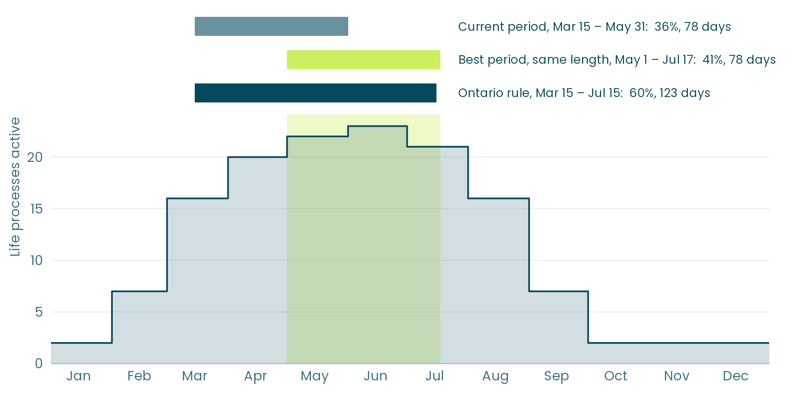
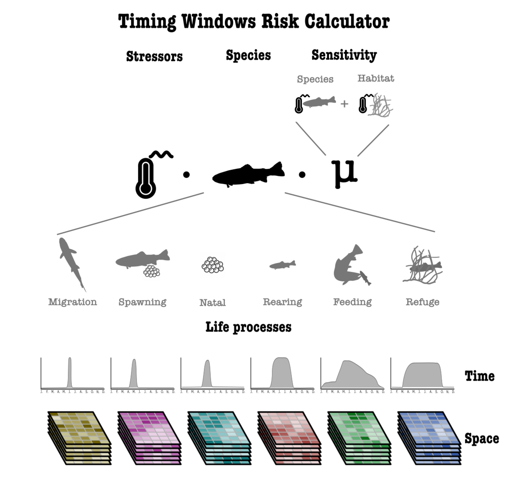

In our [last post](https://insileco.io/en/blog/2026/11/timingwindows/), we introduced timing windows for in-water work and the Timing Windows Calculator, which we built with the [Centre for Ecosystem Management](https://www.ecosystemscience.ca/) to identify periods of lower risk for fish populations in a lake or a river. We closed on its main limit: it looks at when fish spawn, migrate, and rear, and at nothing else.

In this post, we look at what it would take to go further. We explain how a window is scored, what changes when the score is built from the risk fish face at a site rather than from fish timing alone, and what the data available today already allow.

## How windows are set today

Most timing windows come from rules written for broad species groups and seasons, for example spring for warm-water species. Those rules are protective by design, simple to apply, and the same at every site within a region. That is their strength. It is also their limit: a rule cannot know whether a given site holds spawning walleye, rearing pike, or neither, nor whether the fish there already face other pressures.

## How a window is scored

The calculator starts from a simple measure of daily risk: the number of species life processes active on a given day. A day when four species spawn and two are rearing scores 6. Each life process can be weighted by species and by its sensitivity to the stressors of the planned work.

A window's score is then the share of the year's risk that falls inside it:

$$
\text{score} = 100 \times \frac{\sum_{t \in W} r(t)}{\sum_{t=1}^{365} r(t)}
$$

where \(r(t)\) is the risk on day \(t\) and \(W\) the days of the window.

To find the best window of a given length, the calculator slides it across every possible start date and keeps the lowest score for a work window, or the highest for a restricted period. A two-year series takes care of windows that cross December 31. The method is simple enough to reproduce in a spreadsheet for your own site.

On Lake St. Clair, with 12 species, a restricted period from March 15 to May 31 covers 36% of the year's fish activity, and the best period of the same length, May 1 to July 17, covers 41%. Ontario's current rule for spring spawners covers 60%, but it lasts 123 days instead of 78. A longer window will almost always cover more, so windows should only be compared at equal length.

*Daily risk on Lake St. Clair: the number of life processes active each day across the 12 species, from the National Timing Windows Dataset. Each period's score is the share of the shaded area that falls inside it.*

## From fish timing to risk

Fish timing tells us when fish could be harmed. It does not tell us where they are within a lake, which pressures already weigh on them, or how much a given type of work would add. Those are the questions a cumulative risk assessment asks, and the calculator was designed from the start to answer them.

*The full design of the calculator. Risk combines stressors, species, and sensitivity; each species is broken into six life processes (migration, spawning, natal, rearing, feeding, and refuge), each with its own profile in time and distribution in space.*

Written out, the risk at a location \(x\) on a day \(t\) is:

$$
R(x,t) = \sum_{i} \sum_{p} \sum_{j} L_{ip}(x) \, P_{ip}(t) \, S_{j}(x) \, s_{j}(t) \, \mu_{ipj}
$$

For each species \(i\), each of its life processes \(p\), and each pressure \(j\), the model combines five things: where the life process occurs (\(L_{ip}\)), when it occurs (\(P_{ip}\)), how intense the pressure is at that location (\(S_j\)), when during the year it acts (\(s_j\)), and how sensitive the species and its habitat are to it (\(\mu_{ipj}\)). The daily risk then feeds the same score and the same sliding search as before.

The calculator we use today is the simplest case of this model. Space is reduced to one waterbody, the intensity of pressures is not mapped, and every sensitivity is set to 1. Adding data therefore improves the same model rather than replacing it.

This also works in both directions. Where pressures already weigh on a species or a life stage at a site, the window can be made more protective. Where they do not, it can be made less restrictive, which matters as much to the people scheduling the work as to the fish.

## Risk assessment as a function of data availability

The model can be used at different levels, depending on the data at hand:

- **Level 1, temporal windows.** Built from species presence and traits, which are widely available across Canada. This is what the calculator does today, and field surveys and experiments make these windows better.
- **Level 2, spatio-temporal windows.** Windows and risk maps for each site, as positional and telemetry data and spatio-temporal environmental data become available.
- **Level 3, food-web effects.** How a disturbance timed on one life stage could spread to other stages and species through predators and prey.
- **Level 4, climate scenarios.** How windows could shift as temperatures and seasons change.

Levels 1 and 2 can be built with the data that exist today and those now being collected. Levels 3 and 4 are directions for later and would require more research. Each level stays usable with the data at hand, and when local data are added, such as a spawning survey or a new pressure layer, the risk and the windows update.

## Starting with the data at hand

Setting timing windows from risk does not require every dataset to exist first. It can start where the calculator stands today, with fish timing for the species present, and get closer to the risk at each site as surveys, telemetry, and pressure maps come in. Each step makes the windows more defensible, both for the fish they protect and for the work they allow.

You can read more about our projects in our [portfolio](https://insileco.io/en/portfolio/), and as always, never hesitate to reach out to us if you have comments or questions!
