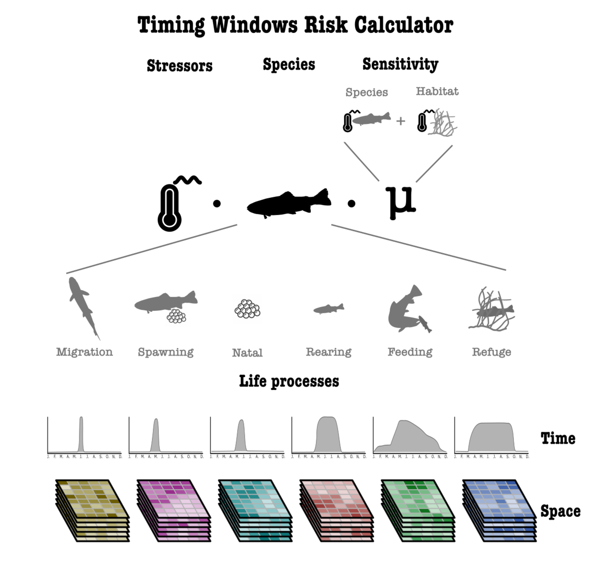

Dans notre [dernier billet](https://insileco.io/fr/blog/2026/11/timingwindows/), nous avons présenté les périodes de travaux en milieu aquatique et le Timing Windows Calculator, que nous avons développé avec le [Centre for Ecosystem Management](https://www.ecosystemscience.ca/) pour déterminer les périodes où le risque est plus faible pour les populations de poissons d’un lac ou d’un cours d’eau. Nous avions conclu sur sa principale limite : il tient compte du moment où les poissons fraient, migrent et grandissent, et de rien d’autre.

Dans ce billet, nous regardons ce qu’il faudrait pour aller plus loin. Nous expliquons comment une période est évaluée, ce qui change lorsque le score repose sur le risque auquel les poissons font face à un site plutôt que sur leur seul calendrier, et ce que les données disponibles aujourd’hui permettent déjà.

## Comment les périodes sont établies aujourd’hui

La plupart des périodes de travaux découlent de règles établies pour de grands groupes d’espèces et pour des saisons, par exemple le printemps pour les espèces d’eau chaude. Ces règles sont protectrices par conception, simples à appliquer et identiques pour tous les sites d’une région. C’est leur force, mais aussi leur limite : une règle ne peut pas savoir si un site donné abrite des dorés jaunes en fraie, de jeunes brochets en croissance ou ni l’un ni l’autre, ni si les poissons qui s’y trouvent subissent déjà d’autres pressions.

## Comment une période est évaluée

Le calculateur part d’une mesure simple du risque quotidien : le nombre d’étapes du cycle de vie des espèces en cours un jour donné. Un jour où quatre espèces fraient et deux en sont à la croissance des jeunes obtient un score de 6. Chaque étape peut être pondérée selon l’espèce et selon sa sensibilité aux facteurs de stress des travaux prévus.

Le score d’une période correspond ensuite à la part du risque annuel qu’elle couvre :

$$
\text{score} = 100 \times \frac{\sum_{t \in W} r(t)}{\sum_{t=1}^{365} r(t)}
$$

où \(r(t)\) est le risque au jour \(t\) et \(W\) les jours de la période.

Pour trouver la meilleure période d’une durée donnée, le calculateur la fait glisser sur toutes les dates de début possibles et retient le score le plus faible pour une période de travaux, ou le plus élevé pour une période de restriction. Une série de deux ans permet de traiter les périodes qui chevauchent le 31 décembre. La méthode est assez simple pour être reproduite dans un tableur pour votre propre site.

Pour le lac Sainte-Claire, avec 12 espèces, une période de restriction du 15 mars au 31 mai couvre 36 % de l’activité annuelle des poissons, alors que la meilleure période de même durée, du 1er mai au 17 juillet, en couvre 41 %. La règle actuelle de l’Ontario pour les espèces qui fraient au printemps en couvre 60 %, mais elle dure 123 jours plutôt que 78. Une période plus longue couvrira presque toujours davantage de risque; il faut donc comparer les périodes à durée égale.

*Risque quotidien au lac Sainte-Claire : le nombre d’étapes du cycle de vie en cours chaque jour pour les 12 espèces, selon le National Timing Windows Dataset. Le score de chaque période est la part de la surface ombrée qu’elle couvre.*

## Du calendrier des poissons au risque

Le calendrier des poissons indique quand ils pourraient subir des dommages. Il n’indique pas où ils se trouvent dans un lac, quelles pressions s’exercent déjà sur eux, ni ce qu’un type de travaux donné y ajouterait. Ce sont les questions que pose une évaluation des risques cumulatifs, et le calculateur a été conçu dès le départ pour y répondre.

*La conception complète du calculateur (figure en anglais). Le risque combine les facteurs de stress, les espèces et la sensibilité; chaque espèce est décomposée en six étapes du cycle de vie (migration, fraie, éclosion, croissance, alimentation et refuge), chacune avec son propre profil dans le temps et sa répartition dans l’espace.*

Sous forme d’équation, le risque à un endroit \(x\) et un jour \(t\) s’écrit :

$$
R(x,t) = \sum_{i} \sum_{p} \sum_{j} L_{ip}(x) \, P_{ip}(t) \, S_{j}(x) \, s_{j}(t) \, \mu_{ipj}
$$

Pour chaque espèce \(i\), chacune de ses étapes du cycle de vie \(p\) et chaque pression \(j\), le modèle combine cinq éléments : l’endroit où l’étape a lieu (\(L_{ip}\)), le moment où elle a lieu (\(P_{ip}\)), l’intensité de la pression à cet endroit (\(S_j\)), le moment de l’année où elle s’exerce (\(s_j\)) et la sensibilité de l’espèce et de son habitat à cette pression (\(\mu_{ipj}\)). Le risque quotidien alimente ensuite le même score et la même recherche par fenêtre glissante que précédemment.

Le calculateur que nous utilisons aujourd’hui est le cas le plus simple de ce modèle. L’espace se réduit à un seul plan d’eau, l’intensité des pressions n’est pas cartographiée et toutes les sensibilités valent 1. Ajouter des données améliore donc le même modèle plutôt que de le remplacer.

Cela fonctionne aussi dans les deux sens. Là où des pressions s’exercent déjà sur une espèce ou un stade de vie à un site, la période peut être rendue plus protectrice. Là où ce n’est pas le cas, elle peut être assouplie, ce qui compte autant pour les personnes qui planifient les travaux que pour les poissons.

## L’évaluation des risques selon les données disponibles

Le modèle peut être utilisé à différents niveaux, selon les données disponibles :

- **Niveau 1, périodes temporelles.** Établies à partir de la présence et des traits des espèces, des données largement disponibles partout au Canada. C’est ce que fait le calculateur aujourd’hui, et les inventaires de terrain et les expériences permettent d’améliorer ces périodes.
- **Niveau 2, périodes spatiotemporelles.** Des périodes et des cartes de risque pour chaque site, à mesure que des données de position et de télémétrie, ainsi que des données environnementales spatiotemporelles, deviennent disponibles.
- **Niveau 3, effets sur le réseau trophique.** Comment une perturbation qui touche une étape du cycle de vie pourrait se propager à d’autres stades et à d’autres espèces par l’entremise des prédateurs et des proies.
- **Niveau 4, scénarios climatiques.** Comment les périodes pourraient se déplacer à mesure que les températures et les saisons changent.

Les niveaux 1 et 2 peuvent être réalisés avec les données qui existent aujourd’hui et celles qui sont en cours de collecte. Les niveaux 3 et 4 sont des pistes pour plus tard et demanderaient davantage de recherche. Chaque niveau reste utilisable avec les données disponibles, et lorsque des données locales s’ajoutent, comme un inventaire de frayères ou une nouvelle couche de pressions, le risque et les périodes se mettent à jour.

## Commencer avec les données disponibles

Établir les périodes de travaux à partir du risque n’exige pas que toutes les données existent d’abord. On peut partir de là où se trouve le calculateur aujourd’hui, avec le calendrier des espèces présentes, puis se rapprocher du risque propre à chaque site à mesure que les inventaires, la télémétrie et les cartes de pressions s’ajoutent. Chaque étape rend les périodes plus défendables, tant pour les poissons qu’elles protègent que pour les travaux qu’elles permettent.

Vous pouvez en apprendre davantage sur nos projets dans notre [portfolio](https://insileco.io/fr/portfolio/), et comme toujours, n’hésitez pas à nous écrire si vous avez des commentaires ou des questions!
