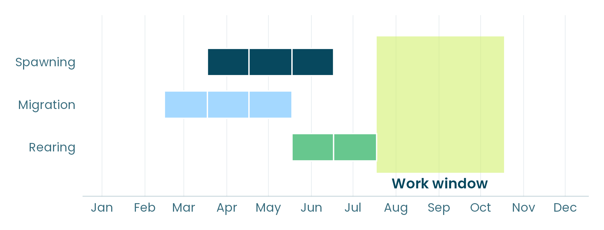
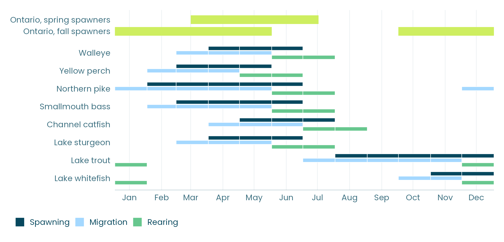

Dredging, shoreline construction, culvert replacement, dam removal, reef building: in-water work cannot always be avoided, but its timing can usually be chosen to minimize the impacts it will have on wildlife. This is usually achieved through the identification of optimal timing windows for in-water work. They set the periods when work may proceed around the fish it could harm, or the restricted periods when it may not, so that life cycles crucial for the health of populations, such as spawning, migration, and rearing, are avoided.

*Walleye, from the National Timing Windows Dataset: migration from March to May, spawning from April to June, and rearing in June and July. A work window from August to October avoids all three.*

With the [Centre for Ecosystem Management](https://www.ecosystemscience.ca/), and with funding from Fisheries and Oceans Canada, we built a tool to identify and score those windows. In this post, we share what it does, how it works, and what data it uses.

## Timing windows in practice

Most timing windows come from rules written for broad species groups and seasons rather than for the species and the site at hand. In Ontario, for example, the South region has two catch-all restricted periods: one for spring spawners (March 15 to July 15) and one for fall spawners (October 1 to May 31).

*Ontario's restricted periods for the South region, set against the months when eight Great Lakes species spawn, migrate, and rear, from the National Timing Windows Dataset.*

Generic rules are simple to apply, and that is their strength. Still, they usually follow spawning seasons, leaving out other periods of importance such as migration and rearing, which often fall outside them: in the figure, the period for spring spawners ends on July 15, while walleye, northern pike, and smallmouth bass are still rearing to the end of July, and channel catfish through August. 

Timing windows should also seek to minimize constraints on project proponents, if possible. Still, they often also restrict work at a site and season where the fish they protect are simply not there. 

Windows set from the fish actually present would protect them where it matters and limit work only where needed in order to maximize protection and minimize constraints simultaneously. It would also likely help reduce the need for exceptions to established timing window restrictions, which is done too often in order to allow in-water work to go forward. 

## The calculator

The Timing Windows Calculator is a web application built by inSileco and the Centre for Ecosystem Management (Kevin McCann, University of Guelph), with funding from Fisheries and Oceans Canada. 

The idea is straightforward: for any Canadian lake or river the calculator scores a timing window against the fish there, and finds the window that reduces risks to fish the most.

## How it works, in four steps

The screens follow a risk management process based on ISO 31000: establish the context, identify, analyse, evaluate, and treat. They follow the order an assessor already uses.

1. **Waterbody.** Pick a lake or a river on the map, or drop a pin on a site.
2. **Species.** The species present are filled in, with their spawning, migration, and rearing timing. Both can be edited with local knowledge.
3. **Works and pressures.** Select the works, undertakings, and activities planned, the stressors they cause, and how sensitive each species is to them.
4. **Calculator.** Compare your window with the current window and the optimal one, then export a report.



*The Timing Windows Calculator on Lake St. Clair, with real fish timing.*

On Lake St. Clair, the 12 species observed are filled in. A restricted period from March 15 to May 31 covers 36% of the year's fish activity, while the best period of the same length, May 1 to July 17, covers 41%. Ontario's current rule for spring spawners in the South region, March 15 to July 15, covers more, at 60%, but it restricts work for 123 days, 45 more than the best window.

## The National Timing Windows Dataset

The calculator runs on the [National Timing Windows Dataset](https://insileco.io/timingWindowsData): 226 Canadian freshwater fish species in 26 linked tables and assembled from open sources. It holds when each species spawns, migrates, and rears, along with its habitat by life stage, its diet, and its thermal tolerance.

Open data have gaps, so the calculator makes its choices visible. Species not observed in a waterbody are inferred from the surrounding watershed and marked as such. Where timing is missing for a species and a life process, the calculator assumes the fish are there all year, which is the protective default. Every table can be edited, so that someone who knows when walleye spawn in their area of interest can say so, and the windows update.

## Limits and next steps

The calculator is a working tool, and it is far from finished. It uses monthly fish timing only, which is coarse for species that spawn over a few weeks. It also does not consider the spatial distribution of fish life stages, or the risks fish already face in the area of interest.

These limits point to the next step, which is setting windows from the risk fish already face at a site: where and when each species spawns, migrates, and rears, which pressures are present, and how much each one harms them. That is what we will look at in the coming posts of this series.

In the meantime, you can read more about our projects in our [portfolio](https://insileco.io/en/portfolio/), and never hesitate to reach out to us if you have comments or questions!
