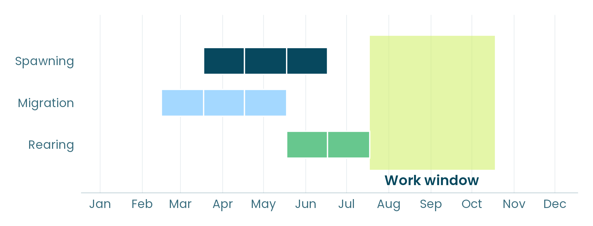
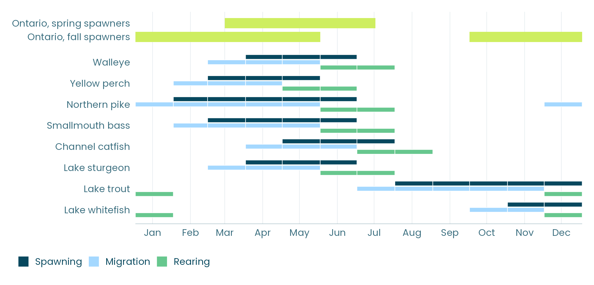

Dragage, construction riveraine, remplacement de ponceaux, démantèlement de barrages, aménagement de récifs : les travaux en milieu aquatique ne peuvent pas toujours être évités, mais on peut généralement choisir le moment où ils sont effectués pour réduire leurs impacts sur la faune. On y parvient habituellement en déterminant des périodes de travaux optimales (les « périodes particulières » de Pêches et Océans Canada). Celles-ci fixent les périodes pendant lesquelles les travaux peuvent avoir lieu en considérant les poissons qu’ils pourraient affecter, ou les périodes de restriction pendant lesquelles ils ne le peuvent pas, afin d’éviter les étapes du cycle de vie essentielles à la santé des populations, comme la fraie, la migration et la croissance des jeunes.

*Le doré jaune, selon le National Timing Windows Dataset : migration de mars à mai, fraie d’avril à juin et croissance des jeunes en juin et juillet. Une période de travaux d’août à octobre évite les trois.*

Avec le [Centre for Ecosystem Management](https://www.ecosystemscience.ca/), et grâce au financement de Pêches et Océans Canada, nous avons développé un outil pour déterminer et évaluer ces périodes. Dans ce billet, nous présentons ce qu’il fait, comment il fonctionne et quelles données il utilise.

## Les périodes de travaux en pratique

La plupart des périodes de travaux découlent de règles établies pour de grands groupes d’espèces et pour des saisons, plutôt que pour les espèces et le site visés. En Ontario, par exemple, la région Sud compte deux périodes de restriction générales : l’une pour les espèces qui fraient au printemps (du 15 mars au 15 juillet), l’autre pour celles qui fraient à l’automne (du 1er octobre au 31 mai).

*Les périodes de restriction de l’Ontario pour la région Sud, comparées aux mois pendant lesquels huit espèces des Grands Lacs fraient, migrent et grandissent, selon le National Timing Windows Dataset.*

Les règles génériques sont simples à appliquer, et c’est là leur force. Elles suivent toutefois généralement les saisons de fraie et laissent de côté d’autres étapes importantes, comme la migration et la croissance des jeunes, qui en sortent souvent. Dans la figure, la période pour les espèces qui fraient au printemps se termine le 15 juillet, alors que les jeunes dorés jaunes, grands brochets et achigans à petite bouche grandissent jusqu’à la fin juillet, et ceux de la barbue de rivière jusqu’à la fin d’août.

Les périodes de travaux devraient aussi, dans la mesure du possible, limiter les contraintes imposées aux promoteurs. Pourtant, elles restreignent souvent les travaux à un site et à une saison où les poissons qu’elles protègent ne sont tout simplement pas présents.

Des périodes établies à partir des poissons réellement présents les protégeraient là où c’est important et ne limiteraient les travaux que là où c’est nécessaire, afin de maximiser la protection tout en réduisant les contraintes. Elles aideraient probablement aussi à réduire le besoin d’exceptions aux restrictions en vigueur, une pratique beaucoup trop courante pour permettre les travaux en milieux aquatiques.

## Le calculateur

Le Timing Windows Calculator est une application Web développée par inSileco et le Centre for Ecosystem Management (Kevin McCann, Université de Guelph), grâce au financement de Pêches et Océans Canada.

L’idée est simple : pour n’importe quel lac ou cours d’eau canadien, le calculateur évalue une période de travaux en fonction des poissons qui s’y trouvent, et identifie la période qui réduit le plus les risques pour ces poissons.

## Son fonctionnement, en quatre étapes

L'application suit un processus de gestion des risques fondé sur la norme ISO 31000 : établir le contexte, identifier, analyser, évaluer et traiter. Ils suivent ainsi l’ordre qu’un évaluateur utilise déjà.

1. **Plan d’eau.** Choisissez un lac ou un cours d’eau sur la carte, ou placez un repère sur un site.
2. **Espèces.** Les espèces présentes sont ajoutées automatiquement, avec leurs périodes de fraie, de migration et de croissance. Les deux peuvent être modifiées à partir des connaissances locales.
3. **Ouvrages et pressions.** Sélectionnez les ouvrages, entreprises et activités prévus, les facteurs de stress qu’ils entraînent et la sensibilité de chaque espèce à ceux-ci.
4. **Calculateur.** Comparez votre période avec la période actuelle et la période optimale, puis exportez un rapport.



*Le Timing Windows Calculator sur le lac Sainte-Claire, avec le calendrier réel des poissons (vidéo en anglais).*

Pour le lac Sainte-Claire, les 12 espèces observées sont ajoutées automatiquement. Une période de restriction du 15 mars au 31 mai couvre 36 % de l’activité annuelle des poissons, alors que la meilleure période de même durée, du 1er mai au 17 juillet, en couvre 41 %. La règle actuelle de l’Ontario pour les espèces qui fraient au printemps dans la région Sud, du 15 mars au 15 juillet, en couvre davantage, soit 60 %, mais elle restreint les travaux pendant 123 jours, 45 de plus que la meilleure période.

## Le National Timing Windows Dataset

Le calculateur repose sur le [National Timing Windows Dataset](https://insileco.io/timingWindowsData), un jeu de données national sur le calendrier biologique des poissons : 226 espèces de poissons d’eau douce du Canada réparties dans 26 tables liées, assemblées à partir de sources ouvertes. Il indique quand chaque espèce fraie, migre et grandit, ainsi que son habitat selon le stade de vie, son régime alimentaire et sa tolérance thermique.

Les données ouvertes comportent des lacunes, alors le calculateur rend ses choix visibles. Les espèces qui n’ont pas été observées dans un plan d’eau sont déduites à partir du bassin versant environnant et signalées comme telles. Lorsque le calendrier d’une étape du cycle de vie manque pour une espèce, le calculateur suppose que les poissons sont présents toute l’année par principe de précaution. Chaque table peut être modifiée, de sorte qu’une personne qui sait quand le doré jaune fraie dans sa zone d’intérêt puisse l’indiquer, et les périodes se mettent à jour.

## Limites et prochaines étapes

Le calculateur est un outil fonctionnel, mais il est loin d'être terminé. Il repose uniquement sur le calendrier mensuel des poissons, ce qui manque de précision pour des espèces qui fraient sur quelques semaines. Il ne tient pas compte de la répartition spatiale des stades de vie des poissons, ni des risques auxquels ils font déjà face dans la zone d'intérêt.

Ces limites indiquent la prochaine étape : établir les périodes à partir du risque auquel les poissons font déjà face à un site, c’est-à-dire où et quand chaque espèce fraie, migre et grandit, quelles pressions sont présentes et à quel point chacune leur nuit. C’est ce que nous aborderons dans les prochains billets de cette série.

D’ici là, vous pouvez en apprendre davantage sur nos projets dans notre [portfolio](https://insileco.io/fr/portfolio/), et n’hésitez pas à nous écrire si vous avez des commentaires ou des questions!
